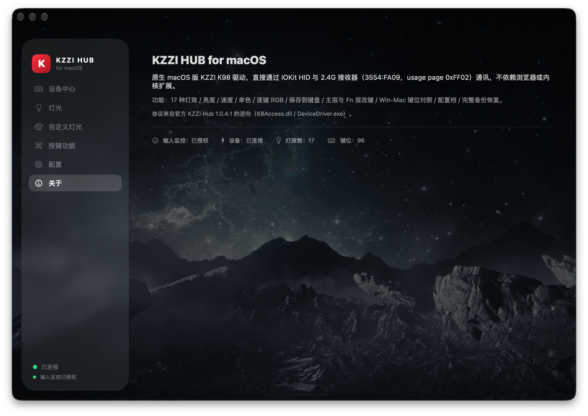

# KZZI HUB for macOS

> Unofficial native macOS driver for the **KZZI K98** 2.4G mechanical keyboard, reverse-engineered
> from the official Windows driver **KZZI Hub 1.0.4.1**.

SwiftUI + IOKit HID. No kernel extension, no browser, no Electron.



## 背景

KZZI（珂芝）K98 只有 Windows 驱动，macOS 下官方没有驱动、也没有网页版驱动：灯效能亮，
但灯效模式、逐键 RGB、改键这些都没法设置。这个项目把 Windows 驱动逆向后，用 Swift
重写了一个原生 macOS 应用，功能对齐 Windows 版。

已在真实的 K98（2.4G 接收器，`3554:FA09`）上验证：连接、读配置、切换灯效、逐键 RGB、
改键、保存到 flash 均正常。

## 功能

| 模块 | 说明 |
|---|---|
| 设备中心 | 连接状态、当前灯效、日志 |
| 灯光 | 17 种灯效、亮度 0–5、速度 0–5、单色、彩虹 |
| 自定义灯光 | 96 键逐键上色（126 个 LED） |
| 按键功能 | Windows / macOS 键位对照、Fn 组合表、主层改键、Fn 层改键（复制/清除） |
| 配置 | 原始配置查看、宏区只读、配置档、完整备份导出/恢复 |
| 安全 | 键位表读不全拒绝写入、改键写完读回校验、失败自动回滚、恢复出厂键位 |

## 下载

下载 [`dist/KZZI-HUB-1.0.0-macOS.zip`](dist/KZZI-HUB-1.0.0-macOS.zip)（或到
[**Releases**](https://github.com/huaxiac4/kzzi-hub-macos/releases) 下载），解压后把
`KZZI HUB.app` 拖进「应用程序」。

- 应用是 ad-hoc 签名、未做 Apple 公证：首次打开请 **右键 → 打开**（或执行 `xattr -cr "KZZI HUB.app"`）
- 首次运行按提示授予「输入监控」权限，然后点「重试连接」
- Release 版**不含**官方键盘图/星空背景（版权原因），界面会用纯色背景；想要完整外观见
  `native/Sources/KZZIHub/Resources/README.md`

## 系统要求

- **macOS 26 及以上**（界面使用 SwiftUI Liquid Glass API）
- 构建需要 Xcode 26+ 工具链

## 构建

```bash
./scripts/build_app.sh
```

脚本会编译 Swift Package 并打包出 `KZZI HUB.app`，然后做 ad-hoc 签名。

> 键盘图片和星空背景属于 KZZI 官方资源，仓库没有包含，缺失时应用会自动降级。
> 想还原完整外观见 `native/Sources/KZZIHub/Resources/README.md`。

## 首次运行

macOS 把 HID 键盘访问归到「输入监控」权限：

1. 打开 `KZZI HUB.app`，按提示点「打开系统设置」
2. 在 **隐私与安全性 → 输入监控** 中勾选 **KZZI HUB**
3. 回到应用点「重试连接」

> 注意：如果从终端 `open` 启动，权限可能归属到终端进程而一直连不上，请从访达双击启动。

## 协议（逆向结果）

设备：`VID 0x3554 / PID 0xFA09`，厂商集合 `usagePage 0xFF02 / usage 2`。
所有命令走 HID **output report 0x13**，20 字节帧：

```
[0]=0x13  [1]=cmd  [2]=sub/#frags  [3]=seq  [4]=dataLen  [5..18]=data  [19]=sum(bytes 0..18)&0xFF
```

| cmd | 含义 |
|---|---|
| `0x07` | ping（每次事务前发） |
| `0x44` / `0x04` | 读 / 写 10 包配置（128 字节） |
| `0x0A` | 保存到 flash |
| `0x41` | 读键位表（36 帧 ×14 = 504 字节，126 条 4 字节记录 `[0][mod][0][HID码]`），帧 `[4]` 高 4 位选层（`0x0E` 主层 / `0x1E` Fn 层） |
| `0x01` | 写键位表 |
| `0x02` / `0x1C` | 逐键 RGB：R/G/B 三平面 × 9 帧 ×14 字节，126 个 LED，seq27 为 `06 00 00 5A A5` 结尾 |
| `0x42` | 读宏区（只读展示） |

配置字段：帧 0 `[15]` 灯效、`[17]` 颜色模式；每个灯效的亮度/速度在帧 4/5/6：
效果 1–6 → 帧 4 `7+(n-1)*2`；7–13 → 帧 5 `5+(n-7)*2`；14–18 → 帧 6 `5+(n-14)*2`。
该字节为亮度，下一字节高 4 位速度、低 4 位颜色模式。

## 目录

```
native/              Swift Package（SwiftUI + IOKit）
  Sources/KZZIHub/
    HID.swift        IOKit HID 直连
    Protocol.swift   帧 / 配置 / 键位 / 逐键 / 保存
    Model.swift      状态与动作
    Views.swift      界面（Liquid Glass）
    Resources/       布局、灯效、键位表（图片需自行提取）
tools/               Python 协议研究工具、自检脚本
scripts/build_app.sh 构建 + 打包
docs/                截图
```

## 已知限制

- **宏**：存储/事件编码已逆向，但通过 2.4G 接收器写入宏区实测不生效，目前只做只读展示。
- **电量 / 系统设置**（休眠、响应时间）：配置字段尚未定位。
- 只支持 K98 这一套布局与灯效表。

## 声明

- 非官方项目，与 KZZI 无关，仅供互操作性和个人使用。
- 仓库不包含官方驱动及其图片资源；请使用你自己设备的安装包提取。
